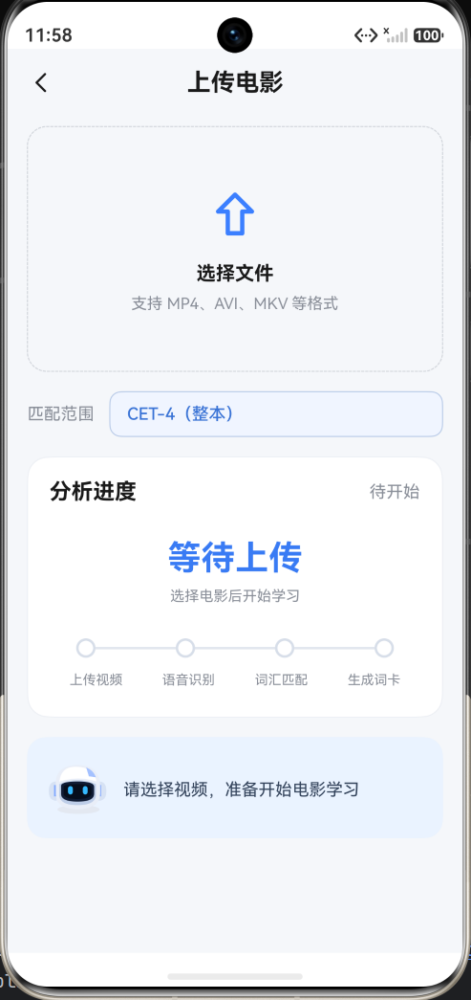
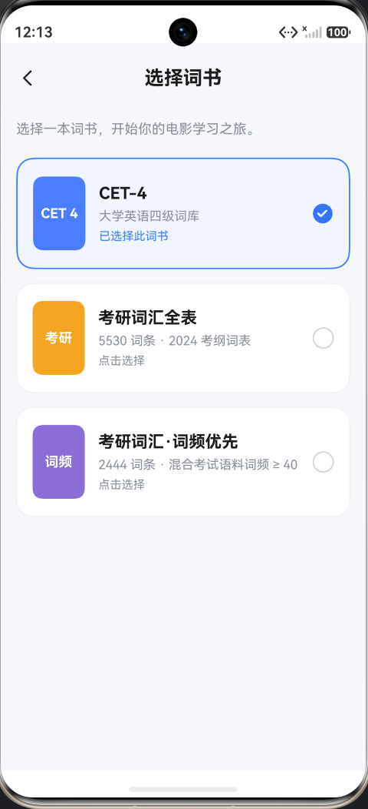
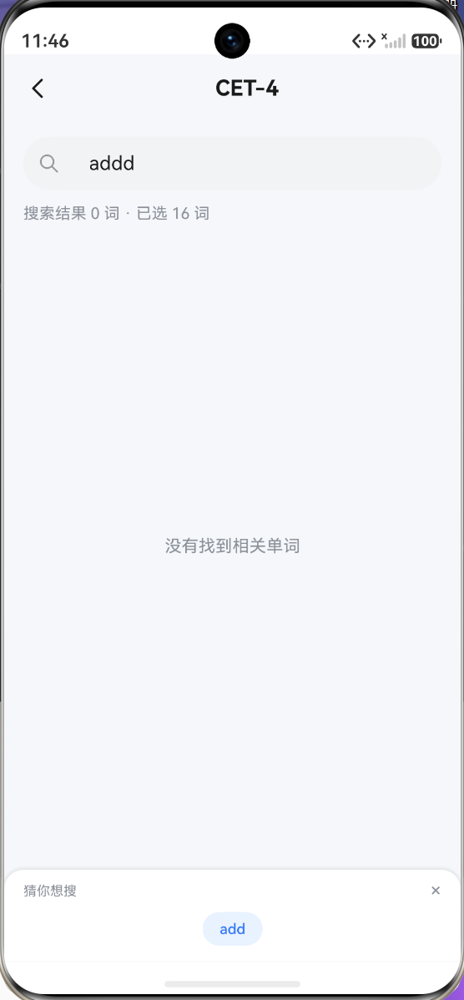
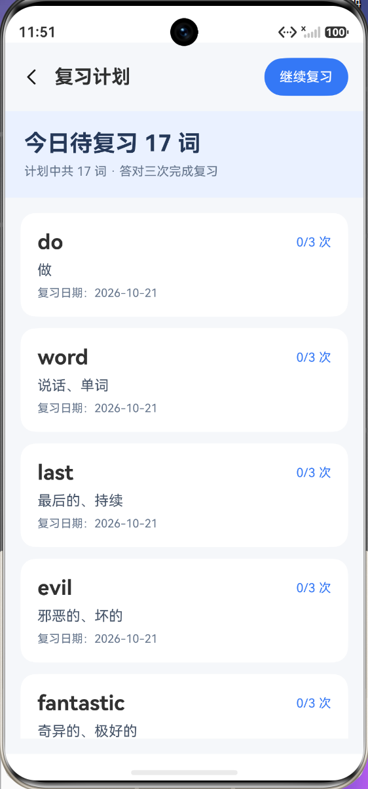
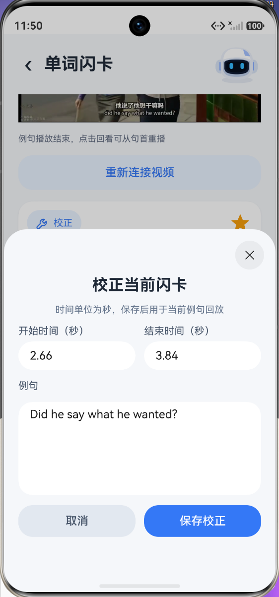
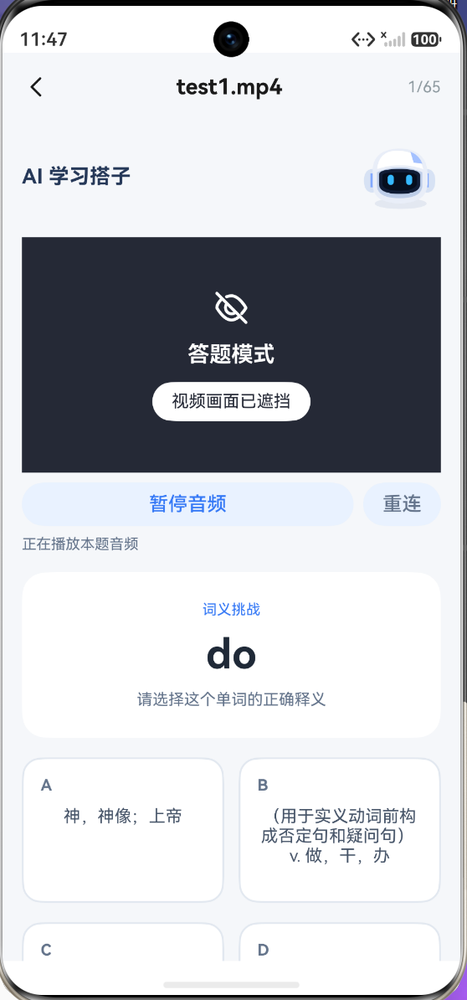
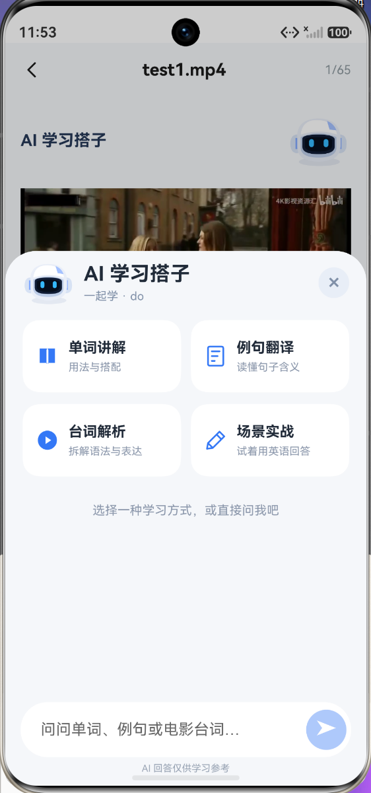
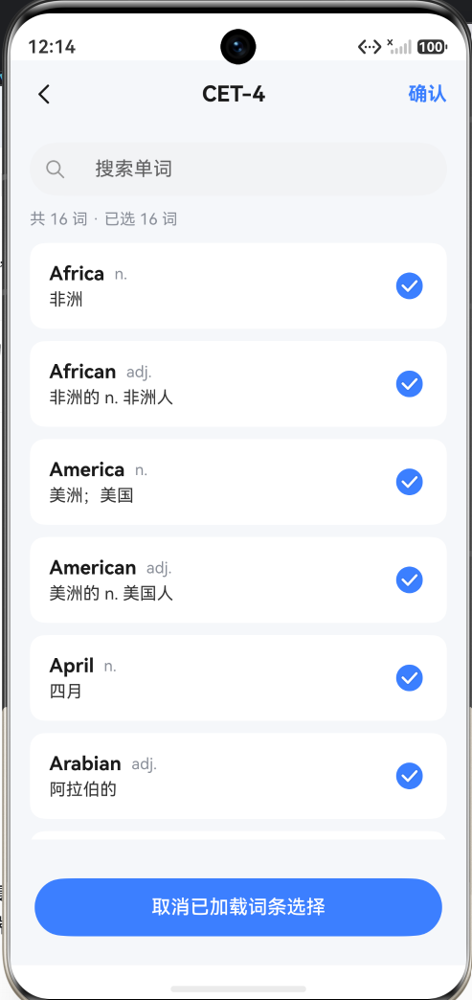

# Hello Word · 在电影台词里学英语

从自己选的英语影片里提取词书中的单词。打开闪卡，就能听到这个词出现的那句原声；答错的词可以加入第 1、3、7 天的复习计划。

**[观看演示视频（4 分 35 秒）](https://github.com/123pqm/hello-word/raw/refs/heads/master/docs/media/hello-word-demo.mp4)** · [鸿蒙客户端](harmony/) · [FastAPI 后端](backend/) · [配置与启动](#配置与启动)

## 应用实机截图

**选择学习内容**

| 学习首页 | 选择影片 | 选择词书 | 猜你想搜 |
| :---: | :---: | :---: | :---: |
| [](docs/media/home.png) | [](docs/media/import-movie.png) | [](docs/media/wordbook.png) | [](docs/media/search.png) |

**看原片、学单词**

| 原片闪卡 | 展开释义与例句 | 校正片段起止时间 | 听原声答题 |
| :---: | :---: | :---: | :---: |
| [](docs/media/flashcard.png) | [](docs/media/reveal.png) | [](docs/media/correct.png) | [](docs/media/quiz-listen.png) |

**答题、提问与复习**

| 对照答案 | AI 快捷提问 | 查看例句解析 | 查看复习计划 |
| :---: | :---: | :---: | :---: |
| [](docs/media/quiz.png) | [](docs/media/assistant.png) | [](docs/media/ai-reply.png) | [](docs/media/review.png) |

## 一部影片怎么变成闪卡？

1. **选影片和词书。** 后端用 Whisper 转写台词，按所选词书匹配单词。开启词形还原后，像 *ran* 这样的变形也能匹配到 *run*。
2. **回到原句。** 点闪卡上的跳转按钮，从句首播放到句末。可以隐藏释义和例句，也可以手动校正例句与时间戳。
3. **听原声，辨词义。** 答题模式使用近似词模型挑选干扰项；同一个模型也用于词库搜索建议。需要解释时，可向 AI 学习搭子询问当前单词或台词。
4. **收藏和复习。** 主动收藏想再看的词，或者开启错题自动收录，按计划复习。

## 配置与启动

**后端。** 准备 Python 3.11、uv、MySQL 8 和 FFmpeg（加入 PATH）。在 Windows PowerShell 中执行：

```powershell
cd backend
uv sync --locked --python 3.11
Copy-Item .env.example .env
```

在 `.env` 填写自己的数据库连接信息及随机生成的 `JWT_SECRET_KEY`。首次启动需要建库、建表权限。AI 问答按所选服务商配置模型、地址和 API Key。不要提交 `.env`。

```powershell
.\dev.ps1
```

服务启动后打开 `http://127.0.0.1:8000/docs`。首次使用，在另一个终端进入 `backend` 导入词库：

```powershell
uv run python -m app.import_words
uv run python -m app.import_netem
uv run python -m app.import_model_supplement resources/spelling_model/data/vocab.json
```

**鸿蒙客户端。** 用 DevEco Studio 打开 `harmony/`，按 `build-profile.json5` 安装相应 SDK、同步依赖并配置自己的签名。在 [AppConfig.ets](harmony/entry/src/main/ets/common/AppConfig.ets) 中修改 `BASE_URL`：真机应填手机可访问的后端地址，例如 `http://<电脑局域网IP>:8000`。手机上的 `127.0.0.1` 指向手机自身。

**测试。** 在 `backend` 配置好 `.env` 的 `JWT_SECRET_KEY` 后执行 `uv run pytest -q`；真实数据库集成测试需要另外启用 `--mysql`。鸿蒙业务逻辑测试位于 [harmony/scripts](harmony/scripts/)，先将 `DEVECO_SDK_HOME` 指向 DevEco Studio 的 SDK 目录，再用 Node.js 运行 `test-*.cjs`。

## 当前实现与未来规划

当前版本使用 **ArkTS / ArkUI 客户端与 FastAPI 后端**，Whisper 转写在后端运行。手机端默认下载 tiny、按需下载更大模型，以及华为云语音转写和 OBS 影片存储，均为后续部署方案。当前可配置的云端大模型问答与规划中的云端语音转写是不同功能。

考研词库的来源与许可见[词库署名说明](backend/resources/vocabulary/netem/ATTRIBUTION.md)。

